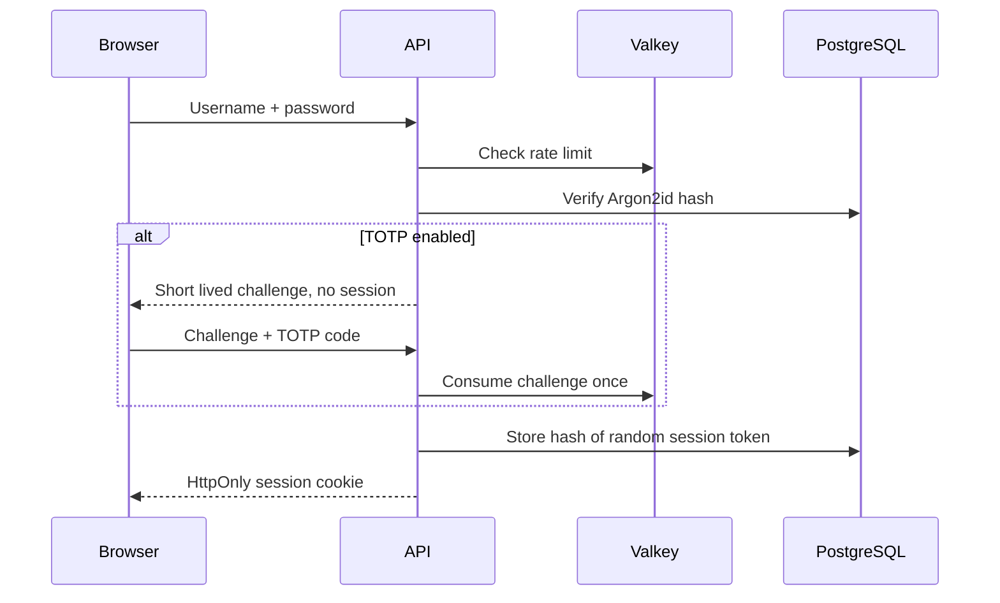

# Authentication and core settings

## Boundary and data

FastAPI is the security boundary. `/dashboard` and `/settings` also check the session in the Next.js server layout and redirect anonymous users to `/login`; every protected API request independently checks the database session. There is no public registration or password reset endpoint. The administrative CLI creates accounts and can reset TOTP.

Alembic revision `0002_auth_core` creates `users`, `sessions`, and `audit_events`. User IDs and session IDs are UUIDs. Timestamps are stored in UTC. The user's initial timezone is `Europe/Zurich` and base currency is `CHF`.

## Login and sessions

Passwords use `argon2-cffi` Argon2id with time cost 3, 64 MiB memory, parallelism 2; changed parameters trigger rehash on login. A dummy hash is verified for unknown usernames to reduce account enumeration. Valkey limits password attempts by IP and username, and TOTP attempts by IP, over configurable windows. Valkey failure prevents login rather than silently disabling the limit. Invalid username and password receive the same error.

The cookie contains a 48-byte URL-safe random token. PostgreSQL holds only its SHA-256 digest. It is `HttpOnly`, `SameSite=Lax`, and `Secure` in production. The default lifetime is 168 hours. Logout marks the session revoked; expired, revoked, or inactive-user sessions cannot access protected endpoints. Celery Beat deletes expired and previously revoked records hourly. The token is never put in browser storage. Changing the TOTP state revokes other sessions; administrative TOTP reset revokes all sessions.

## TOTP and recovery

An authenticated user starts setup on `/api/v1/auth/totp/setup`. The API returns a secret and `otpauth://` URI with `Cache-Control: no-store`; the pending secret is encrypted with Fernet in PostgreSQL and expires after ten minutes. `/api/v1/auth/totp/confirm` accepts a valid six-digit code before enabling the factor. Subsequent password login returns a five-minute, one-use challenge bound to the client IP. `/api/v1/auth/totp/verify` accepts a code within one time step of clock drift and rejects reuse of an accepted time step. No full session exists before this step. A local operator can run `make reset-totp` after verifying account ownership out of band. Losing `TOTP_ENCRYPTION_KEY` makes encrypted factors unrecoverable; keep it with protected backups.

## CSRF, CORS and audit

Credentialed CORS allows only `FRONTEND_ORIGIN`. The API compares the `Origin` of state-changing requests with configured frontend and API origins, and rejects browser cross-site requests without an Origin using Fetch Metadata. Together with `SameSite=Lax`, this protects cookie-authenticated writes. Keep both origins exact, including scheme and port. Caddy will own the final ingress/header policy in the production phase.

`AuditService` writes structured events for login success/failure, logout, TOTP setup/enable/reset, user creation and setting changes. It receives field names rather than secrets. Security state changes and their audit records commit in one transaction; if that commit fails, the operation fails closed. A failed-login audit write is best effort so an audit outage does not turn an already invalid credential into a successful login; the failure is logged server-side. Login rate limits still fail closed when Valkey is unavailable.
