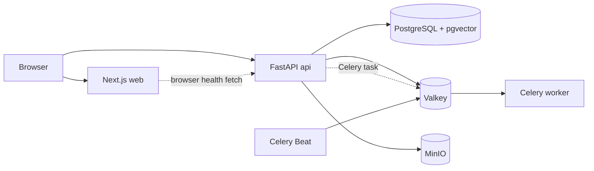

# Implemented system overview

The repository is one application codebase with seven local Compose services. P1–P3 provide authentication, raw storage, stable instruments and validated market/FX versions. P4 adds portfolio accounting and a separate private production stack; P5 adds versioned fundamentals, research, watchlists, news and estimate snapshots. New external sources remain gated and disabled. The normative phase sequence remains Master Plan section 158.

FastAPI and Celery import the same `backend/app` settings and domain services. HTTP routes stay in `app/api`; infrastructure adapters live in `app/core` and `app/db`. Alembic owns schema changes, currently through `0009_filing_document`. Portfolio and research pages read validated local versions, never live providers. Exact raw bytes precede parsing; missing inputs and corrections remain explicit.

The status page calls the API from the browser. Readiness probes SQL, Valkey and MinIO access; failed dependencies do not yield invented success. MinIO stores financial originals under the implemented immutable raw-ingestion contract. Object smoke tests use a separate disposable key.

Request IDs travel in `X-Request-ID` and structured UTC JSON logs. Local ports are localhost-bound. Caddy/private TLS, authentication, Prometheus/Grafana, backups and isolated recovery are implemented. Actual homelab/VPN, client CA trust, independent backup storage, daily host schedule and encrypted key recovery still require target acceptance. P5 does not close that production gate or start P6.
