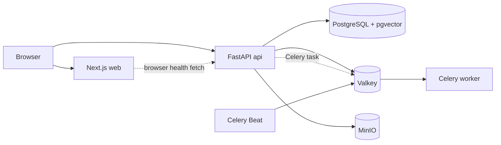

# Implemented system overview

The current repository is a single application codebase with seven local Compose services. It contains no domain data or financial collectors yet.

FastAPI and Celery import the same `backend/app` settings and future domain services. HTTP routes stay in `app/api`; infrastructure adapters live in `app/core` and `app/db`. Alembic owns database schema changes. The first migration enables the vector extension but creates no domain tables.

The status page calls the API from the browser. The API's readiness response probes a SQL `SELECT 1`, Valkey `PING`, and MinIO bucket access. It does not return invented success when a dependency is down. MinIO's bucket is created automatically on first successful probe; object tests use a disposable `smoke/` key. Financial raw data will have a separate immutable ingestion contract in a later phase.

Request IDs travel in `X-Request-ID` and structured UTC JSON logs. The application ports are bound to localhost in Compose. Caddy, authentication and production monitoring are outside this assignment.
