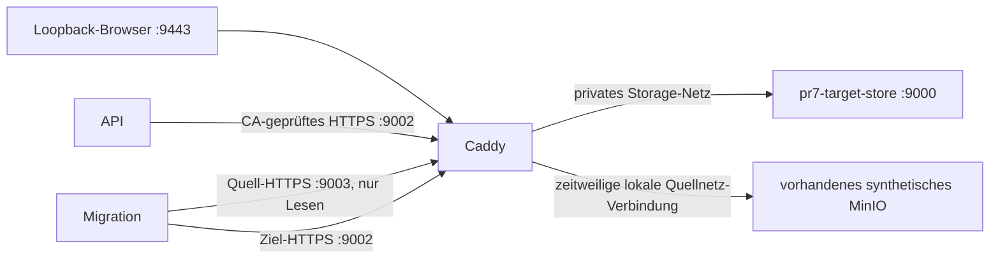

# PR7 – getrenntes synthetisches Anwendungs-Staging

Stand26.10.2026. **Keine produktive Installation oder Umschaltung.**
`ops/docker-compose.pr7-staging.yml` ergänzt den Produktionsvertrag unter einem
neuen Projektnamen. Die geprüften Imagepins stehen im
[aktuellen Runtimeinventar](../security/pr7-20261026-rc2/inventory.json).
Paketabnahme, Anwendungskompatibilität und Operatorfreigabe bleiben getrennt.

## Tatsächliche Netzgrenzen



Nur der Gateway gehört zusätzlich zum ausdrücklich benannten lokalen Quellnetz.
Der Quellcontainer wird mit seinem eindeutigen vollständigen Containernamen
angesprochen. Der Zielstore hat den eigenen Alias `pr7-target-store`; ein
mehrdeutiger `minio`-Alias zwischen zwei Netzen wird nicht für das Gateway benutzt.
Ebenso verwendet der HTTPS-Apppfad ausschließlich `pr7-stage-api` und
`pr7-stage-web`. Generische API-/Webaliase waren beim ersten HTTPS-Probelauf
zwischen Quell- und Stagingnetz mehrdeutig; dessen403-Fehlerbeleg bleibt erhalten.
API/Web/MLflow gehören nicht zum Storage- oder Quellnetz. Master-/Filer-/Volume-/
gRPC-Ports werden nicht am Host veröffentlicht. TLS endet am privaten Gateway;
die Backendverbindung zum Store ist HTTP innerhalb des getrennten Storage-Netzes.
Das ist kein Nachweis einer TLS-Verbindung bis in jeden Storageprozess.

## Vorbereitung

1. Neuen Projektnamen und private Umgebungsdatei außerhalb von Git verwenden.
   Eigene PostgreSQL-, S3-, MLflow-, Grafana- und Fernetwerte erzeugen.
   `APP_ENV=staging`, `APP_DOMAIN=localhost`, Frontend/API-Origin
   `https://localhost:9443`; alle Collector-/Forward-Schalter bleiben aus.
2. `PR7_API_IMAGE` und `PR7_WEB_IMAGE` auf die exakt gescannten Digests setzen.
   `PR7_S3_CONFIG` enthält eigene synthetische S3-Identitäten: Administrator nur
   für Bootstrap/Vertragsprobes, Anwendung mit Read/Write/List. Die Quellcredentials
   werden nur im kurzlebigen Migrationsprozess benötigt, nicht im Appserver.
3. `PR7_SOURCE_HOST`/`PR7_SOURCE_NETWORK` ausdrücklich auf die lokale synthetische
   Quelle setzen. Keine Quellvolumes in das Staging einhängen. Quelle vor dem
   konsistenten Dump/Referenzexport quiescieren; alle Änderungen danach müssen
   durch die Manifestprüfung erkannt werden.
4. Private Composekonfiguration mit beiden Dateien prüfen, ohne sie mit ihren
   Secrets auszugeben. Neue Volumes initialisieren; `nocopy` verhindert die
   Übernahme der Imageverzeichnis-UID. Anschließend nur DB, Valkey, Store und
   Gateway starten, CA exportieren und den leeren versionierten Zielbucket
   anlegen. Appschreiber bleiben bis zum verifizierten Kopierende aus.

```text
docker compose --env-file private/stage.env -f docker-compose.prod.yml -f ops/docker-compose.pr7-staging.yml config --quiet
docker compose --env-file private/stage.env -f docker-compose.prod.yml -f ops/docker-compose.pr7-staging.yml run --rm --no-deps storage-init
```

Die kleinen Volume-/Speicherlimits dieser Datei begrenzen den QA-Lauf; sie sind
keine Kapazitätsabnahme für einen späteren echten Zielhost.

## Migration und Archivprüfung

Der [allgemeine Kopiervertrag](PR7_S3_MIGRATION.md) inventarisiert mit
`PR7_S3_MANIFEST_V2` auch ursprüngliche Änderungszeitpunkte. Ein früherer
V1-Testmanifest bleibt lesbar, wird für eine neue Kopie nicht stillschweigend
umgeschrieben. Quellversionsmenge und Zeitstempel werden vor und nach der Kopie
geprüft. DB-Verfügbarkeitsdaten werden dadurch nicht ersetzt oder rückdatiert.

Der vollständige neue Bestandstest kopierte683 Originalobjekte und prüfte323
DB-Referenzen. Unveränderte Quelle, prozessübergreifende Wiederaufnahme und
idempotente Wiederholung bestanden. Nach einem Windows-Leselock wurde derselbe
Bestand aus dem Journal fortgesetzt. Kurzzeitige Sharing-Locks erhalten begrenzte
Wiederholungen; ein dauerhafter Lock ist ein Fehler und erhält den vorigen
vollständigen Checkpoint. Die ursprünglichen Fehlerbelege bleiben erhalten.

Danach wurde der konsistente DB-Dump in die eigene neue PostgreSQL17-Instanz
geladen. Alle aufgezeichneten Historienhashes stimmen überein, einschließlich
alter Dataset-/Modellverträge und separater Dokumentrückzugs-/UI-Anfragebelege.
Die tatsächliche App-Storagefactory bestand Quelle→Ziel→Quelle für Originale,
Modellarchiv und verfügbares Dokumentoriginal. Das ist eine begrenzte
Lesesimulation von Cutover/Rollback; der normale Appendpoint wurde nicht geändert.
Die bestehende Entwicklungsquelle verwendet dabei ausdrücklich ihren lokalen
Quellkontext; sie wird nicht mit Entwicklungscredentials als produktiv freigegeben.

Belege liegen privat unter `backups/pr7-full-stage-v1/evidence/`:
`migration-result.json`, `source-checkpoint.json`, `target-checkpoint.json`,
`factory-cutover-rollback.json`. Keine Objektlisten/DB-Referenzen veröffentlichen.

## Tatsächlich bestandene weitere Verträge

- Vier leere Remote-gRPC-Adminanfragen aus einem anderen Storage-Netz-Peer wurden
  mit gRPC16 abgewiesen. Sie konnten auch bei einem Fehler keine Identität ändern.
- Verweigerte normale PUT- und signierte POST-Uploads wurden mit403 abgelehnt.
- Native Versionierung und COMPLIANCE-Retention: Löschung der gesperrten
  konkreten Version verweigert, Originalbytes weiterhin identisch lesbar.
- Gepatchtes MLflow3.17.2: unauthentisierte Metadaten verweigert,
  Jobausführung aus, authentisierter Artefakt-/Bild-Roundtrip über S3/TLS bestanden.

Die anschließende Native-/RAG-/HTTPS-/Ausfall-/Zielbackup-Abnahme besteht im
unten dokumentierten Umfang. Die einzelnen Phasen haben getrennte Belege;
vorherige fehlgeschlagene Versuche werden nicht in erfolgreiche umbenannt.

## CPU-Runtime und Zielbackup

Der neue CPU-Kandidat verwendet die offiziellen Ollama0.40.11-Binärdateien aus
dem vollständig SHA-geprüften Releasearchiv. Er installiert CPU-Bibliotheken
und deren Lizenzen, läuft unter UID10001 und erhält das Modellvolume read-only.
GPU-/Vulkan-/MLX-Unterstützung gehört nicht zu diesem Profil. Zwei vorhandene
öffentliche Modelle werden bytegenau kopiert; private Ollama-Identitätsschlüssel
werden nicht übernommen. Ein neuer Runtimepin erzeugt neue Embeddingversionen;
alte Chunks/Vektoren werden nicht umgeschrieben oder als passend umetikettiert.
Vor dem read-only-Start wird auch das leere Verzeichnis `manifests-v2` angelegt.
`OLLAMA_NOPRUNE=true` verhindert, dass der Server dieses Verzeichnis beim
Neustart zu löschen versucht. Beide konkreten anfänglichen Startfehler bleiben
in den privaten Probelaufbelegen erhalten. Der Servingprozess erhält weiterhin
keinen Schreibzugriff auf die Modellbytes.

Für ein Zielbackup müssen dieselben Composeoverrides und das richtige Projekt
gelten. Das Werkzeug unterstützt dafür den expliziten Override:

```text
python ops/backup.py --compose-file docker-compose.prod.yml --compose-override ops/docker-compose.pr7-staging.yml --env-file private/stage.env --root private/target-backup --bucket pr7-staging-raw
```

Ein neuer isolierter Restore des Zielbackups muss erneut alte Hashes,
Dokumentrückzüge, technische Wiederholungsbelege und exakt CHF10’180 erhalten.
Lokale C:-QA-Backups schließen keinen unabhängigen produktiven Backupmount,
Zeitplan, VPN-/Client-CA- oder Schlüsselrecoveryentscheid.

Für die nachvollziehbare Versionszuordnung unterstützt das Backup außerdem
`--migration-evidence-dir private/evidence`: Die drei festen JSON-Belege
`migration-manifest.json`, `migration-journal.json`, `references.json` sowie ein
vorhandener passender `migration-result.json` werden bytegenau aufgenommen.
Vier vorhandene Source-/Initialtarget-/Post-QA-/Delta-Checkpoints ergänzen die
ausdrückliche Allowlist; ein Post-QA-Checkpoint verlangt seinen geprüften
Baselinevergleich und darf keinen anderen geschützten Archivhash ersetzen.
Manifesthash, vollständiger Journalstatus und Referenzidentität müssen passen.
Das Werkzeug durchsucht keine Umgebungs-/Credentialdateien. Die Belege erhalten
eigene Einträge in der Backup-Hashliste und werden vor dem Restore mitgeprüft.
Ein Mirror stellt aktuelle Objektkeys und die expliziten `__pr7_archive`-Bytes
wieder her; er behauptet keine identischen nativen Ziel-Version-IDs oder einen
Snapshot weiterer Testbuckets.
Der vorhandene Backupclient setzt im Image `MC_CONFIG_DIR=/tmp/.mc`.
Die CA wird deshalb unter `/tmp/.mc/certs/CAs` gemountet. Der erste Zielbackup-
Versuch scheiterte mit unbekannter CA, weil der frühere Mount auf `/root/.mc`
zeigte. Die CA-Prüfung wird für die Korrektur nicht abgeschaltet; der
fehlgeschlagene Backupset bleibt erhalten.

## Abschließende tatsächliche Ergebnisse27.10.

Native Auswahl: Backend PR7rc5 mit unveränderten numerischen Pins,
PR7_COMPACT_LABEL_SELECTION_V1, vorgewärmtes Ollama0.40.11; erstes Ereignis2064ms,
gespeicherte AVAILABLE-Antwort28’783ms, separates Vorladen25’010ms. Mit gestopptem
Modell gespeicherte LLM_UNAVAILABLE-Ersatzantwort4249ms. Vorherige120s-Fehler
bleiben archiviert. Kein kalter SLA und keine reale Finanzvalidierung.

Falsches Passwort und widerrufene Session werden401 verweigert. DB-/Storeausfall
liefern503-Readiness; nach jedem Neustart besteht die frische aktuelle
Goldenbewertung10180. Private Prometheus3.15.1-/Grafana12.4.13-Probes bestehen:
API-Scrape up, Rules geladen, anonyme Grafana-API401, authentisierte
Prometheus-Datasourcehealth OK. Scheduler-/Hostabnahme bleibt separat.

Zielbackup20261027T073831Z-54136:1372 Objektdateien inklusive Quellversionsarchiv,
acht Evidenzdateien und DB-Dump,1381 Hashes. Der vollständige isolierte Restore
verwendet Backend PR7rc6, PostgreSQL17 und Seaweed4.51. Alte Dataset-/Modell- und
P8–P10-/PR1/PR2-/PR6-Hashes bestehen, Legacyprüfung network none/read-only und
Cleanup ebenfalls. Nur der globale Collectionhash wurde nach zwei tatsächlichen
QA-Ergänzungen neu aufgenommen: eine Dokumentquelle, eine Kursversion. Ein
separat restaurierter eingefrorener Quelldump bestätigt alle alten Zeilen exakt;
keine entfernte oder geänderte ursprüngliche Zeile. Originalcheckpoints bleiben erhalten.

Der alte Goldenbestand ist heute korrekt STALE_PRICE/PARTIAL mit Gesamtwert null.
Sein vollständiger Wert10180 wird ausschließlich am belegten Sourcecheckpoint-
Cutoff26.10.2026 15:18:05.987683 UTC geprüft. Dafür gibt es den ausdrücklichen
Restoreparameter `--valuation-as-of`; `--expect-current-issue STALE_PRICE`
fordert zusätzlich die heutige Sperre ohne Nullersatz. Ohne Cutoff bleibt
weiterhin die heutige vollständige Bewertung Voraussetzung. Keine Daten werden
aufgefrischt oder rückdatiert. Ein eigenes frisches Portfolio besteht separat
die aktuelle HTTPS-Browserbewertung.

Der finale Web-PR7rc7-Browser verwendet tatsächlich dieselbe HTTPS-Origin für
Login/API und zeigt keine Seitenfehler. Seine eigene Self-signed-CA-Ausnahme
ist im Beleg ausgewiesen; separat bestand der strikte Python-CA-Test. Das ist
kein OS-Clientvertrauen. Nach der Abschlussprobe sind alle Stagingdienste
physisch gestoppt, einschließlich optionaler Profile (`--profile '*' stop`).
Normalmodus/Testrollen/Collection/Forward sind im Entwicklungsprojekt zurückgesetzt.

Private Phasenbelege: `status-resume.json`, `status-native-v8.json`,
`status-backup-v10.json`, `status-monitoring-final-web.json` sowie unter
`evidence/` die einzelnen HTTP-/RAG-/Monitoring-/Collectiondelta-Receipts.
Der gültige finale Restorebeleg liegt unter `backups/s7-v1/runtime/restore-status.json`.
Die vorherigen Restorefehler bleiben als gesonderte Dateien erhalten.
